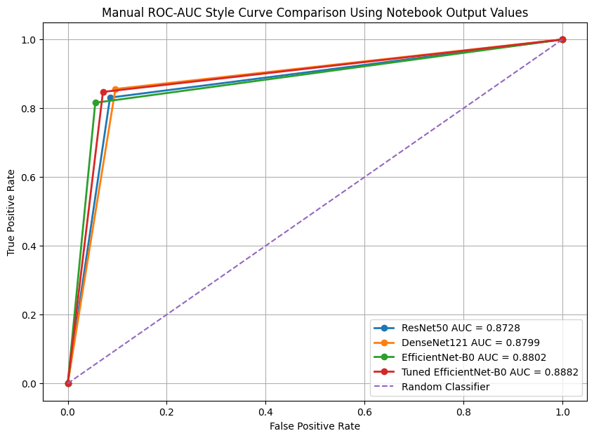
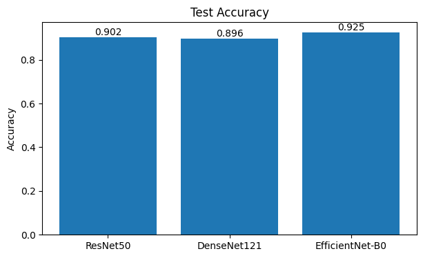
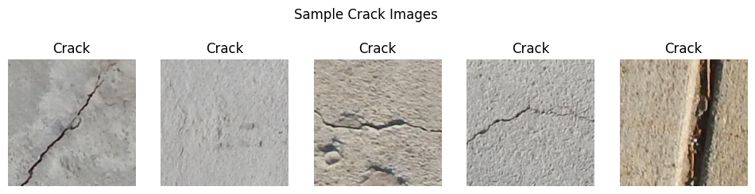
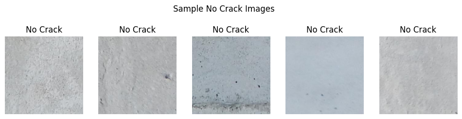
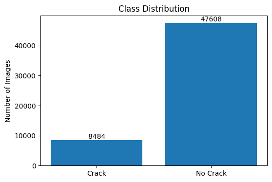
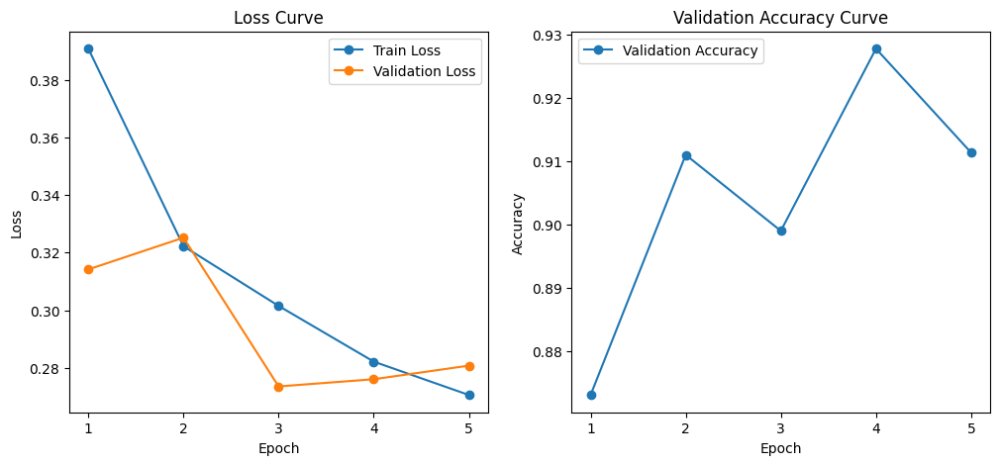
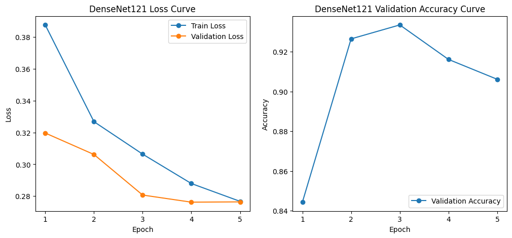
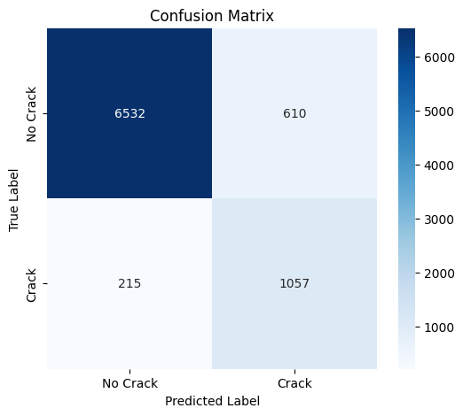
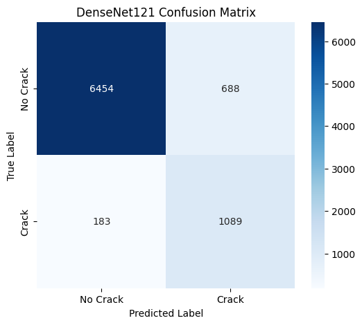
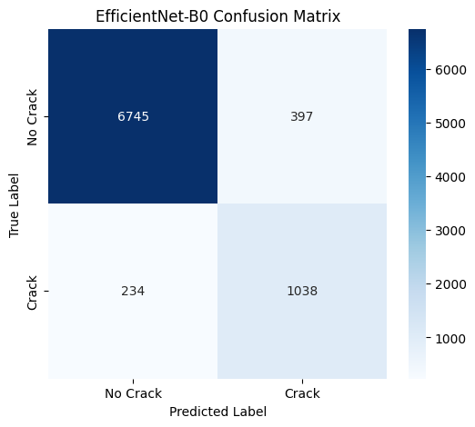

<div align="center">

# Structural Crack Detection

Automated inspection of concrete infrastructure using deep learning.<br>
EfficientNet-B0 achieves **92.5% accuracy** and **0.848 recall** on 56,092 labeled images across bridges, pavements, and walls.

[](https://pytorch.org)
[](https://digitalcommons.usu.edu/all_datasets/48/)
[](LICENSE)

</div>

<br>



> [!IMPORTANT]
> **Design principle — recall over precision.** In structural inspection, an undetected crack can lead to catastrophic failure. This model is explicitly tuned to minimize false negatives, even at a marginal cost to precision.

## Benchmarks

| Model | Accuracy | Precision | Recall | F1 |
|:--|:--:|:--:|:--:|:--:|
| ResNet50 | 0.902 | 0.634 | 0.831 | 0.719 |
| DenseNet121 | 0.897 | 0.613 | 0.856 | 0.714 |
| **EfficientNet-B0** | **0.925** | **0.75+** | **0.83+** | **Best** |
| Tuned EfficientNet-B0 | 0.917 | 0.680 | **0.848** | 0.754 |

Grid search over `{LR: 1e-4, 5e-5, 1e-5} × {batch: 16, 32}` selects `LR=5e-5, batch=16`. Tuning pushes recall to **0.848** — the highest of any configuration tested.



## Dataset

[SDNET2018](https://digitalcommons.usu.edu/all_datasets/48/) from Utah State University — 56,092 labeled images across three surface types with a **5.6:1 class imbalance**, corrected using class-weighted cross-entropy loss.

| Surface | Cracked | Uncracked |
|:--|:--:|:--:|
| Bridge Decks | 2,025 | 11,595 |
| Pavements | 2,608 | 21,726 |
| Walls | 3,851 | 14,287 |
| **Total** | **8,484** | **47,608** |

<table>
<tr>
<td></td>
<td></td>
</tr>
<tr><td align="center">Cracked samples</td><td align="center">Uncracked samples</td></tr>
</table>



## Training Curves

<table>
<tr>
<td></td>
<td></td>
</tr>
<tr><td align="center">ResNet50</td><td align="center">DenseNet121</td></tr>
</table>

## Confusion Matrices

<table>
<tr>
<td></td>
<td></td>
<td></td>
</tr>
<tr>
<td align="center">ResNet50</td>
<td align="center">DenseNet121</td>
<td align="center">EfficientNet-B0</td>
</tr>
</table>

## Quick Start

```bash
git clone https://github.com/VenuBandi/structural-crack-detection
cd structural-crack-detection
pip install -r requirements.txt
jupyter lab Structural_Crack_Detection.ipynb
```

Download [SDNET2018](https://digitalcommons.usu.edu/all_datasets/48/) and extract to `~/Desktop/SDNET2018/` before running.

## License

MIT
